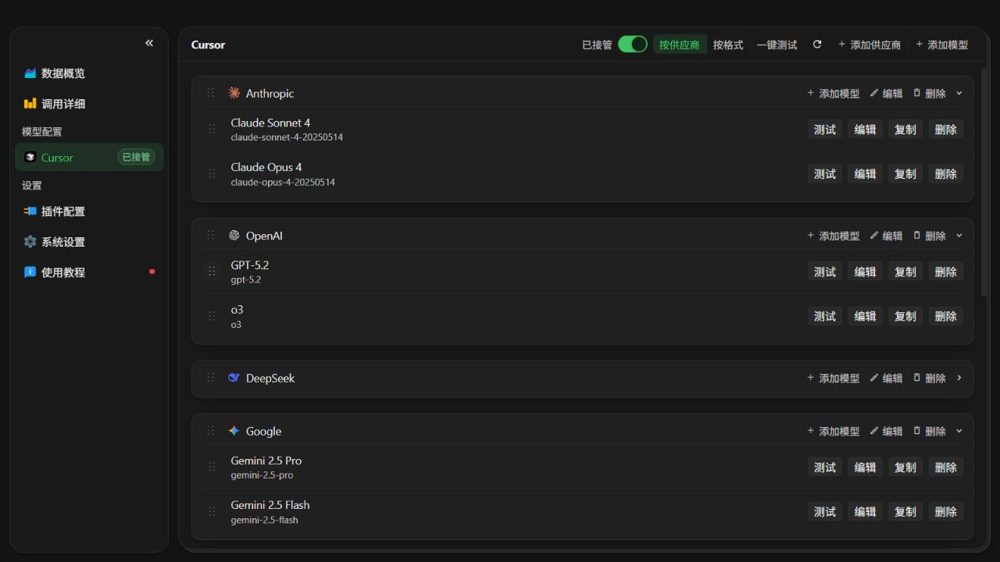
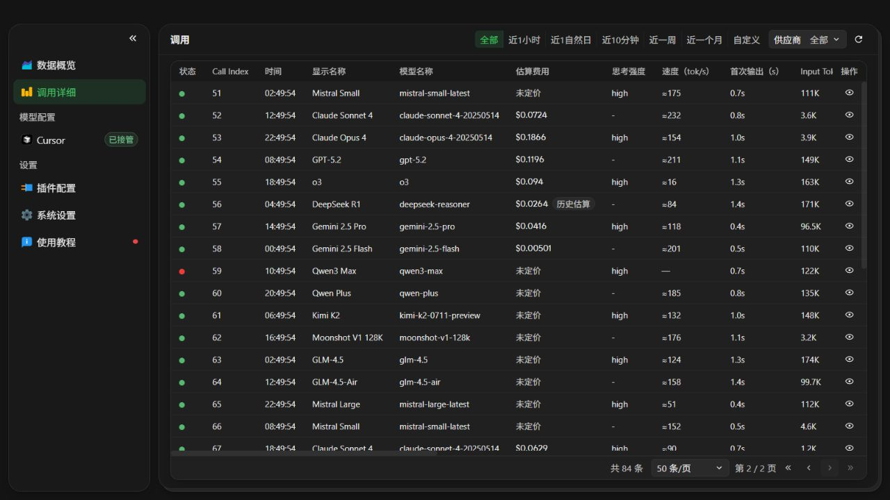

# Cursor BYOK

在 Cursor 中使用你自己的模型 API。这个 Windows 个人魔改版独立维护 Cursor 协议适配，并提供桌面界面来配置模型、查看调用和管理费用。

**[下载 Windows x64 版](https://github.com/Judgecut/cursor-byok/releases/latest)** · [版本记录](https://github.com/Judgecut/cursor-byok/releases) · [English](./README.md)


*截图来自当前桌面界面，使用虚拟数据。*

## 开始使用

1. 在[最新发布](https://github.com/Judgecut/cursor-byok/releases/latest)下载 Windows x64 安装包（`.exe`）或便携包（`.zip`）。便携包解压后即可运行。
2. 在应用的 **Cursor** 页面添加供应商和模型，选择请求格式，填写服务地址和 API Key，再测试模型连通性。
3. 在同一页面开启 **Cursor 接管**，按应用提示完成配置。发出首个请求后，可在 **调用详细** 中查看结果。

## 魔改版功能

- **用量和费用总览。** 按模型或供应商查看 Token 和费用趋势，查看缓存命中率、生成速度，并跟踪周、月、年费用额度。
- **按模型配置请求。** 同一供应商下可混用 OpenAI Chat Completions、OpenAI Responses、Anthropic Messages 和 Gemini 原生格式。每个模型可单独设置请求 URL 和额外参数。
- **调用记录。** 按模型、供应商和时间筛选，查看失败详情、Token 用量、缓存上报情况和估算费用的计算依据。

### 模型管理



### 调用记录



## 工作原理

```text
Cursor 客户端 ── Agent 请求与工具结果 ──► 本机 Cursor BYOK
                                              │
                                              ▼
                                          已配置的模型 API
```

Cursor BYOK 在本机适配 Cursor 协议，并处理会话状态、工具调用、Skills 和 MCP。供应商凭据和应用设置保存在本机，模型请求会发送到你配置的供应商。

这是独立维护的个人 fork。Cursor 客户端更新后，协议适配可能需要跟进调整。目前发布 Windows x64 安装包和便携包。

## 从源码构建

需要 Rust stable、Node.js 22 或更新版本，以及 [Tauri 的 Windows 前置依赖](https://v2.tauri.app/start/prerequisites/)。

```powershell
npm --prefix apps/desktop ci
npm --prefix apps/desktop run tauri:dev
```

安装 Make 后，可以用 `make build-desktop` 构建 Windows NSIS 安装包，产物位于 `target/release/bundle/nsis/`。检查命令见[测试说明](./TESTING.md)。

## 致谢与许可

本项目 fork 自 [hainuoli/cursor-byok](https://github.com/hainuoli/cursor-byok)，源自 [leookun/cursor-byok](https://github.com/leookun/cursor-byok)。这是非官方项目，由个人独立维护。

[MIT 许可证](./LICENSE) · [第三方许可](./THIRD-PARTY-LICENSES.md)
