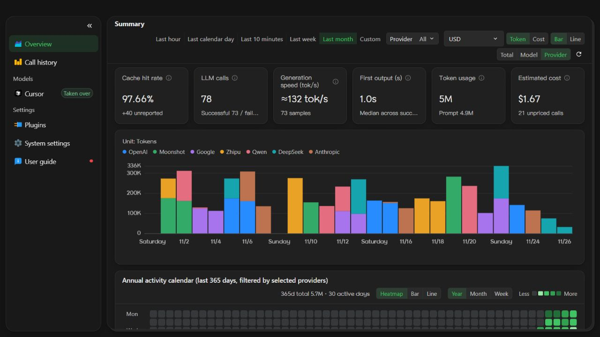
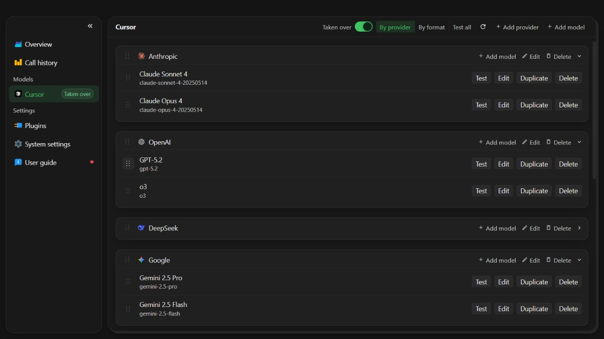
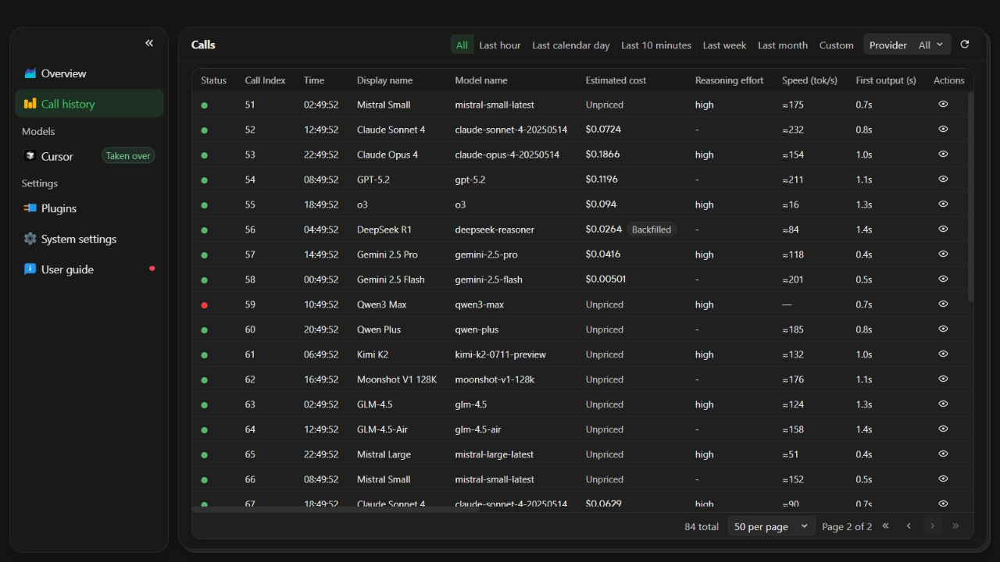

# Cursor BYOK

Bring your own model APIs to Cursor. This personal Windows fork maintains its own Cursor protocol adapter and adds a desktop console for model configuration, usage, and costs.

**[Download for Windows x64](https://github.com/Judgecut/cursor-byok/releases/latest)** · [Release history](https://github.com/Judgecut/cursor-byok/releases) · [简体中文](./README-CN.md)



*Screenshots show the current desktop UI with simulated data.*

## Get started

1. Open the [latest release](https://github.com/Judgecut/cursor-byok/releases/latest) and choose the Windows x64 installer (`.exe`) or portable archive (`.zip`). Extract the portable archive before launching the app.
2. On the app's **Cursor** page, add a provider and a model. Choose the request format, enter the provider's endpoint and API key, and test the model.
3. Enable **Cursor takeover** on the same page and follow the app's setup prompts. Check **Call history** after your first request.

## What this fork adds

- **Usage and cost overview.** Compare token and cost trends by model or provider, inspect cache hit rates and generation speed, and track weekly, monthly, and yearly spending against your quotas.
- **Per-model configuration.** Mix OpenAI Chat Completions, OpenAI Responses, Anthropic Messages, and native Gemini under the same provider. Set a request URL and additional parameters for individual models.
- **Call history.** Filter calls by model, provider, and time. Inspect failures, token usage, cache reporting, and how estimated costs were calculated.

### Model management



### Call history



## How it works

```text
Cursor client ── Agent requests and tool results ──► Cursor BYOK on your PC
                                                     │
                                                     ▼
                                              Configured model API
```

Cursor BYOK adapts Cursor's protocol and manages conversation state, tool calls, Skills, and MCP locally. Provider credentials and app settings are stored on your machine. Model requests are sent to the provider you configure.

This is an independently maintained personal fork. Cursor client updates can require changes to the protocol adapter. Windows x64 is the supported release platform.

## Build from source

Requires Rust stable, Node.js 22 or newer, and the [Tauri prerequisites for Windows](https://v2.tauri.app/start/prerequisites/).

```powershell
npm --prefix apps/desktop ci
npm --prefix apps/desktop run tauri:dev
```

With Make installed, `make build-desktop` builds the Windows NSIS installer under `target/release/bundle/nsis/`. See [Testing](./TESTING.md) for the check commands.

## Credits and license

Forked from [hainuoli/cursor-byok](https://github.com/hainuoli/cursor-byok), based on the original [leookun/cursor-byok](https://github.com/leookun/cursor-byok). This project is unofficial and independent of Cursor.

[MIT License](./LICENSE) · [Third-party licenses](./THIRD-PARTY-LICENSES.md)
